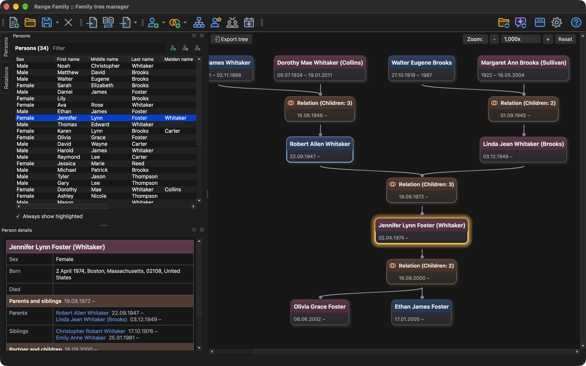

# Range Software - Family

Range Family is an open-dource desktop application for family tree management.



## Help and tutorials

1. [General help](./src/family/help/general/en/index.md)
2. [Tutorials](./src/family/help/tutorials/en/index.md)

## Prepare build environment
Initialize all submodules
```
git submodule update --init --recursive
```
The following command will attempt to download and install all required packages, therefore it must be executed under a privileged (root) user
```
sudo ./src/range-build-tools/prereqs.sh
```
_NOTE: In case your OS does not provide you with Qt version 6.12 or newer download and install it from [https://www.qt.io/download/](https://www.qt.io/download/)._
## Build
```
cmake -S src -B build-Release && \
cmake --build build-Release --parallel
```
## Create installation packages and installers
```
cmake --build build-Release --target package
```
## Installation using generated installers
### Windows

### MacOS
#### Drag & Drop
```
open './build-Release/range-family-1.3.0-darwin-arm64.dmg'
```
### Linux
#### Self extracting Tar GZip
```
./build-Release/range-family-1.3.0-linux-x86_64.sh
```
#### Debian DEB package
```
sudo apt install ./build-Release/range-family-1.3.0-linux-x86_64.deb
```
#### RedHat RPM package
```
sudo dnf install ./build-Release/range-family-1.3.0-linux-x86_64.rpm
```

## Store packages

Ordinary releases are built with the `package` target and distributed as a
notarized DMG, an Inno Setup installer and Linux packages. The Apple App Store
and the Microsoft Store need different artifacts, which are produced by their own
targets and enabled with `-DRANGE_STORE_BUILD=ON`.

A store build also defines `STORE_BUILD`, which removes the built-in software
update checker - both stores forbid an application from installing its own
updates.

### Apple App Store

The bundle is sandboxed, signed with the two _3rd Party Mac Developer_
certificates and wrapped in an installer package:

```
cmake -S src -B build-store -DCMAKE_BUILD_TYPE=Release       -DRANGE_STORE_BUILD=ON       -DMACOS_BUNDLE_IDENTIFIER=com.range-software.family       -DMACOS_APP_STORE_APP_CERT="3rd Party Mac Developer Application: ... (TEAMID)"       -DMACOS_APP_STORE_INSTALLER_CERT="3rd Party Mac Developer Installer: ... (TEAMID)"       -DMACOS_PROVISION_PROFILE=/path/to/range-family.provisionprofile
cmake --build build-store --parallel
cmake --build build-store --target mac-app-store
```

`MACOS_BUNDLE_IDENTIFIER` has to match the application record in App Store
Connect. The entitlements granted to the sandbox are listed in
`src/range-build-tools/packaging/macos/app.entitlements.in`; bundled helper
executables (`family-tool`, `openssl`) inherit the sandbox of the application.

### Microsoft Store

The installation tree is packed into an MSIX package with `makeappx.exe` from the
Windows SDK:

```
cmake -S src -B build-store -DCMAKE_BUILD_TYPE=Release ^
      -DRANGE_STORE_BUILD=ON ^
      -DMSIX_IDENTITY_NAME=RangeSoftware.RangeFamily ^
      -DMSIX_PUBLISHER="CN=..." ^
      -DMSIX_PUBLISHER_DISPLAY_NAME="Range Software"
cmake --build build-store --parallel
cmake --build build-store --target msix
```

`MSIX_IDENTITY_NAME` and `MSIX_PUBLISHER` have to match the values reserved in
Partner Center, otherwise the upload is rejected. The package is not signed by
the build: the Store signs it during ingestion. Sign it locally with `signtool`
only to side-load it for testing.

### Continuous integration

The `Store packages` workflow builds both packages on demand
(_Actions_ - _Store packages_ - _Run workflow_) and can upload the macOS package
to App Store Connect. It expects these repository secrets:

| Secret | Purpose |
| --- | --- |
| `MAC_APP_STORE_CERT_P12` | Base64 `.p12` holding both _3rd Party Mac Developer_ certificates |
| `MAC_APP_STORE_CERT_P12_PASSWORD` | Password of the above |
| `MAC_PROVISION_PROFILE` | Base64 Mac App Store provisioning profile |
| `MACOS_APP_STORE_APP_CERT` | Name of the application signing identity |
| `MACOS_APP_STORE_INSTALLER_CERT` | Name of the installer signing identity |
| `MAC_KEYCHAIN_PASSWORD`, `AC_API_KEY_P8`, `AC_API_KEY_ID`, `AC_API_ISSUER_ID` | Shared with the release workflow |

and the repository variables `MACOS_BUNDLE_IDENTIFIER`, `MSIX_IDENTITY_NAME`,
`MSIX_PUBLISHER` and `MSIX_PUBLISHER_DISPLAY_NAME`.

## Download
To download already built binaries please visit http://range-software.com

## Powered by

* Qt - https://www.qt.io/
