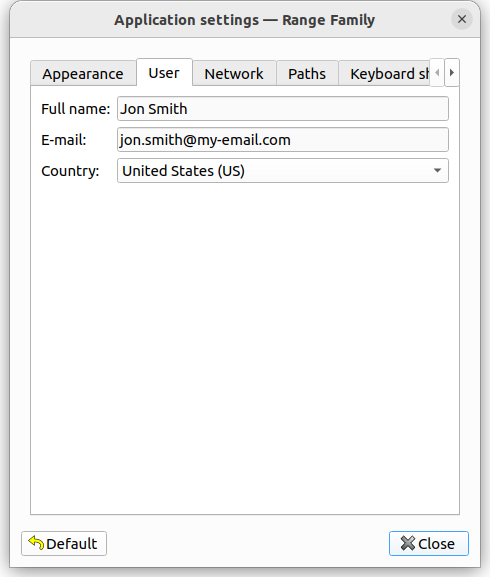
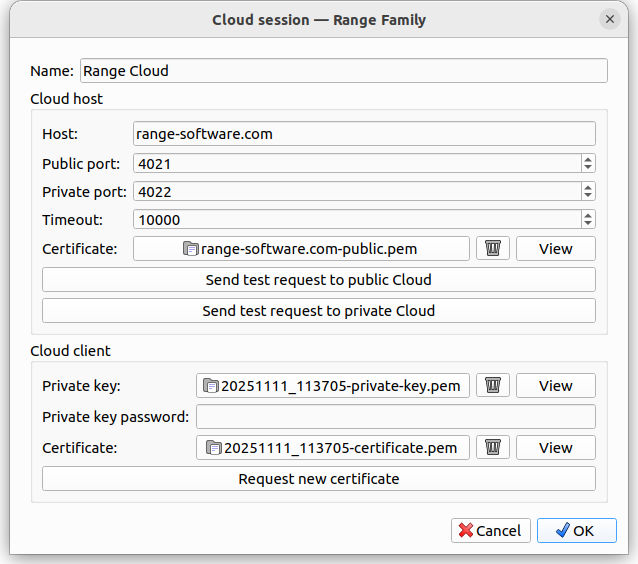

# Cloud - Registrace uživatele

Registrovaní uživatelé **Range Cloud** se mohou ověřit klientským certifikátem podepsaným CA nebo dočasným jednorázovým *ověřovacím tokenem*. Tento návod ukazuje, jak zaregistrovat nového uživatele na **Range Cloud**. Celý proces registrace se skládá z následujících kroků:
1. Vytvoření nového *uživatelského účtu*
2. Vygenerování dočasného jednorázového *ověřovacího tokenu*
3. Vygenerování *žádosti o podepsání certifikátu (CSR)*
4. Odeslání *CSR* na **Range Cloud** pomocí nově vytvořeného *uživatelského účtu* a vygenerovaného *ověřovacího tokenu*
5. Stažení *klientského certifikátu podepsaného CA* z **Range Cloud** a jeho nastavení pro další použití

Díky *Správci relací Cloud* se celý tento proces zjednoduší na několik kliknutí.

## 1. Potvrďte nebo změňte uživatelská nastavení

**Nabídka:** *Soubor -> Nastavení aplikace*

Nejprve se ujistěte, že máte vyplněné osobní údaje.

## 2. Otevřete Správce relací Cloud

**Nabídka:** *Cloud -> Správce relací Cloud*

Ponechte všechny hodnoty beze změny a klikněte na tlačítko *Požádat o nový certifikát*.

## 3. Vygenerujte žádost o podepsání certifikátu (CSR)

V nově otevřeném dialogovém okně *Žádost OpenSSL o podepsání certifikátu* vyplňte všechna chybějící pole subjektu certifikátu a klikněte na tlačítko *Vygenerovat žádost o podepsání certifikátu*.

**Poznámka:** *Pole CN* musí obsahovat e-mailovou adresu, která bude použita jako vaše *uživatelské jméno* na **Range Cloud**.

## 4. Zaregistrujte nového uživatele

Jakmile je *CSR* vygenerována, její obsah se zobrazí v dříve prázdné textové oblasti. Pokračujte kliknutím na tlačítko *Registrovat nového uživatele*, které na **Range Cloud** požádá o vytvoření nového *uživatelského jména* spolu s *ověřovacím tokenem*.

Po úspěšném vytvoření nového *uživatelského účtu* se zobrazí potvrzovací dialogové okno s údaji o uživateli. Po kliknutí na tlačítko *OK* se *CSR* odešle na **Range Cloud**.

## 5. Podepsání uživatelského certifikátu

Po úspěšném zpracování *CSR* a podepsání *klientského certifikátu* certifikační autoritou **Range CA** se zobrazí dialogové okno nabízející použití nově vygenerovaného klíče a podepsaného certifikátu. Přijměte jej.

## 6. Přijměte vygenerovaný klíč a podepsaný certifikát

Dialogové okno *Správce relací Cloud* nyní zobrazuje správné názvy souborů *Soukromý klíč* a *Certifikát*. Kliknutím na tlačítko *OK* se uloží pro další použití.

