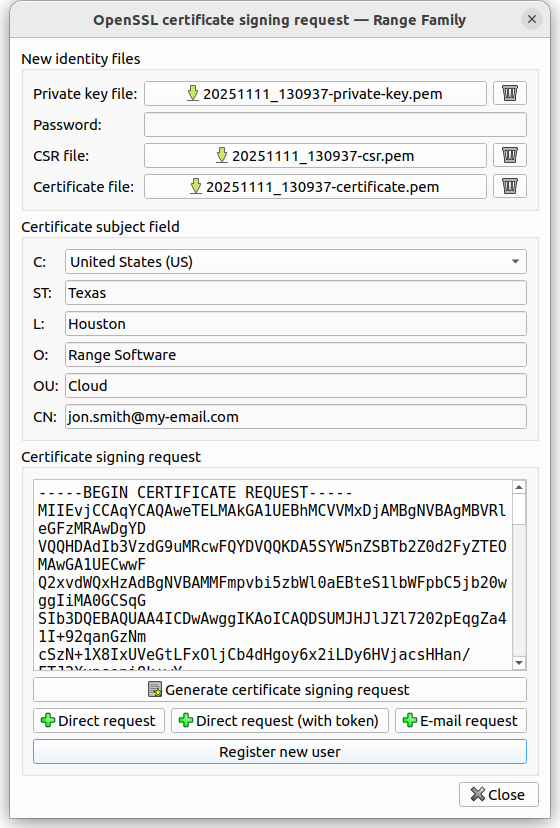
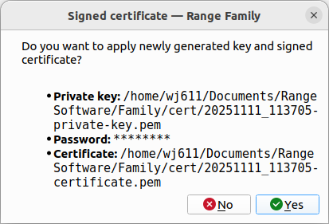

# Cloud - Benutzerregistrierung

Registrierte Benutzer von **Range Cloud** können sich mit einem von der CA signierten Client-Zertifikat oder mit einem temporären einmaligen *Authentifizierungstoken* anmelden. Diese Anleitung zeigt, wie ein neuer Benutzer bei **Range Cloud** registriert wird. Die Registrierung besteht aus folgenden Schritten:
1. Anlegen eines neuen *Benutzerkontos*
2. Erzeugen eines temporären einmaligen *Authentifizierungstokens*
3. Erzeugen einer *Zertifikatsignierungsanforderung (CSR)*
4. Senden der *CSR* an **Range Cloud** mit dem neu angelegten *Benutzerkonto* und dem erzeugten *Authentifizierungstoken*
5. Abrufen des *von der CA signierten Client-Zertifikats* von **Range Cloud** und Einrichten für die weitere Verwendung

Mit der *Cloud-Sitzungsverwaltung* wird dieser gesamte Vorgang auf wenige Klicks vereinfacht.

## 1. Benutzereinstellungen bestätigen oder ändern

**Menü:** *Datei -> Anwendungseinstellungen*

Vergewissern Sie sich zuerst, dass Ihre persönlichen Angaben eingetragen sind.

## 2. Cloud-Sitzungsverwaltung öffnen

**Menü:** *Cloud -> Cloud-Sitzungsverwaltung*

Lassen Sie alle Werte unverändert und klicken Sie auf die Schaltfläche *Neues Zertifikat anfordern*.

## 3. Zertifikatsignierungsanforderung (CSR) erzeugen

Füllen Sie im neu geöffneten Dialogfenster *OpenSSL-Zertifikatsignierungsanforderung* alle fehlenden Felder des Zertifikatsubjekts aus und klicken Sie auf die Schaltfläche *Zertifikatsignierungsanforderung erzeugen*.

**Hinweis:** Das *Feld CN* muss eine E-Mail-Adresse enthalten, die als Ihr *Benutzername* bei **Range Cloud** verwendet wird.

## 4. Neuen Benutzer registrieren

Sobald die *CSR* erzeugt ist, wird ihr Inhalt im zuvor leeren Textbereich angezeigt. Klicken Sie zum Fortfahren auf die Schaltfläche *Neuen Benutzer registrieren*, die bei **Range Cloud** einen neuen *Benutzernamen* zusammen mit einem *Authentifizierungstoken* anfordert.

Sobald ein neues *Benutzerkonto* erfolgreich angelegt wurde, erscheint ein Bestätigungsdialog mit den Benutzerdaten. Nach einem Klick auf die Schaltfläche *OK* wird die *CSR* an **Range Cloud** gesendet.

## 5. Benutzerzertifikat signieren

Nachdem die *CSR* erfolgreich verarbeitet und das *Client-Zertifikat* von der **Range CA** signiert wurde, erscheint ein Dialogfenster, das anbietet, den neu erzeugten Schlüssel und das signierte Zertifikat zu übernehmen. Bestätigen Sie es.

## 6. Erzeugten Schlüssel und signiertes Zertifikat übernehmen

Das Dialogfenster *Cloud-Sitzungsverwaltung* zeigt nun die richtigen Dateinamen für *Privater Schlüssel* und *Zertifikat* an. Ein Klick auf die Schaltfläche *OK* speichert sie für die weitere Verwendung.

