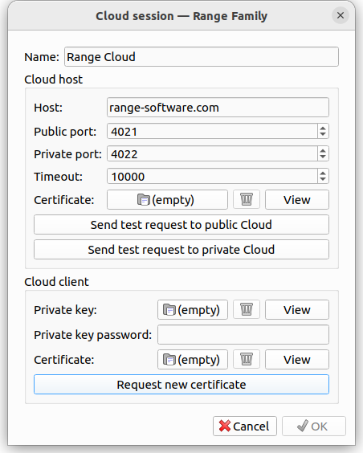
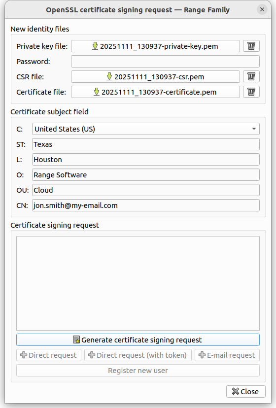

# Cloud - Registro de usuario

Los usuarios registrados de **Range Cloud** pueden autenticarse con un certificado de cliente firmado por la CA o con un *token de autenticación* temporal de un solo uso. Esta guía muestra cómo registrar un nuevo usuario en **Range Cloud**. Todo el proceso de registro consta de los siguientes pasos:
1. Creación de una nueva *cuenta de usuario*
2. Generación de un *token de autenticación* temporal de un solo uso
3. Generación de una *solicitud de firma de certificado (CSR)*
4. Envío de la *CSR* a **Range Cloud** con la *cuenta de usuario* recién creada y el *token de autenticación* generado
5. Obtención del *certificado de cliente firmado por la CA* desde **Range Cloud** y su configuración para uso futuro

Con el *Administrador de sesiones de Cloud*, todo este proceso se reduce a unos pocos clics.

## 1. Confirme o cambie la configuración del usuario

**Menú:** *Archivo -> Configuración de la aplicación*

Primero, asegúrese de que su información personal está configurada.

## 2. Abra el Administrador de sesiones de Cloud

**Menú:** *Cloud -> Administrador de sesiones de Cloud*

Deje todos los valores como están y haga clic en el botón *Solicitar un nuevo certificado*.

## 3. Genere la solicitud de firma de certificado (CSR)

En la ventana de diálogo *Solicitud de firma de certificado de OpenSSL* que se abre, rellene todos los campos que falten del sujeto del certificado y haga clic en el botón *Generar solicitud de firma de certificado*.

**Nota:** El *campo CN* debe contener una dirección de correo electrónico que se usará como su *nombre de usuario* en **Range Cloud**.

## 4. Registre un nuevo usuario

Una vez generada la *CSR*, su contenido se muestra en el área de texto, antes vacía. Para continuar, haga clic en el botón *Registrar un nuevo usuario*, que solicitará a **Range Cloud** la creación de un nuevo *nombre de usuario* junto con un *token de autenticación*.

Cuando la nueva *cuenta de usuario* se haya creado correctamente, aparecerá una ventana de confirmación con los datos del usuario. Tras hacer clic en el botón *OK*, la *CSR* se enviará a **Range Cloud**.

## 5. Firma del certificado de usuario

Una vez procesada correctamente la *CSR* y firmado el *certificado de cliente* por **Range CA**, aparecerá una ventana de diálogo que ofrece aplicar la clave recién generada y el certificado firmado. Acéptela.

## 6. Acepte la clave generada y el certificado firmado

La ventana de diálogo *Administrador de sesiones de Cloud* muestra ahora los nombres de archivo correctos de *Clave privada* y *Certificado*. Al hacer clic en el botón *OK* se guardarán para uso futuro.

