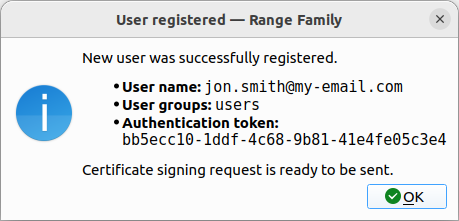

# Cloud - Реєстрація користувача

Зареєстровані користувачі **Range Cloud** можуть автентифікуватися за допомогою клієнтського сертифіката, підписаного CA, або тимчасового одноразового *токена автентифікації*. Цей посібник показує, як зареєструвати нового користувача в **Range Cloud**. Увесь процес реєстрації складається з таких кроків:
1. Створення нового *облікового запису користувача*
2. Генерування тимчасового одноразового *токена автентифікації*
3. Генерування *запиту на підписання сертифіката (CSR)*
4. Надсилання *CSR* до **Range Cloud** за допомогою щойно створеного *облікового запису* та згенерованого *токена автентифікації*
5. Отримання *клієнтського сертифіката, підписаного CA*, з **Range Cloud** і його налаштування для подальшого використання

З *Менеджером сеансів Cloud* увесь цей процес зводиться до кількох клацань.

## 1. Підтвердіть або змініть налаштування користувача

**Меню:** *Файл -> Налаштування програми*

Спершу переконайтеся, що ваші особисті дані заповнено.

## 2. Відкрийте Менеджер сеансів Cloud

**Меню:** *Cloud -> Менеджер сеансів Cloud*

Залиште всі значення без змін і натисніть кнопку *Запит на новий сертифікат*.

## 3. Згенеруйте запит на підписання сертифіката (CSR)

У щойно відкритому діалоговому вікні *Запит на підписання сертифіката OpenSSL* заповніть усі відсутні поля суб'єкта сертифіката й натисніть кнопку *Згенерувати запит на підписання сертифіката*.

**Примітка:** *Поле CN* має містити адресу електронної пошти, яка використовуватиметься як ваше *ім'я користувача* в **Range Cloud**.

## 4. Зареєструйте нового користувача

Щойно *CSR* буде згенеровано, його вміст з'явиться в раніше порожньому текстовому полі. Щоб продовжити, натисніть кнопку *Зареєструвати нового користувача*, яка запросить у **Range Cloud** створення нового *імені користувача* разом із *токеном автентифікації*.

Після успішного створення нового *облікового запису* з'явиться вікно підтвердження з даними користувача. Після натискання кнопки *OK* *CSR* буде надіслано до **Range Cloud**.

## 5. Підписання сертифіката користувача

Після успішної обробки *CSR* і підписання *клієнтського сертифіката* центром **Range CA** з'явиться діалогове вікно з пропозицією застосувати щойно згенерований ключ і підписаний сертифікат. Прийміть її.

## 6. Прийміть згенерований ключ і підписаний сертифікат

Діалогове вікно *Менеджер сеансів Cloud* тепер показує правильні назви файлів *Приватний ключ* і *Сертифікат*. Натискання кнопки *OK* збереже їх для подальшого використання.

